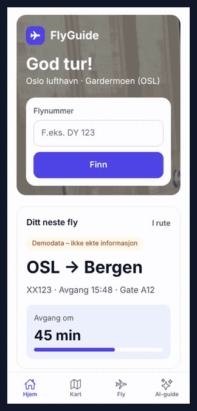
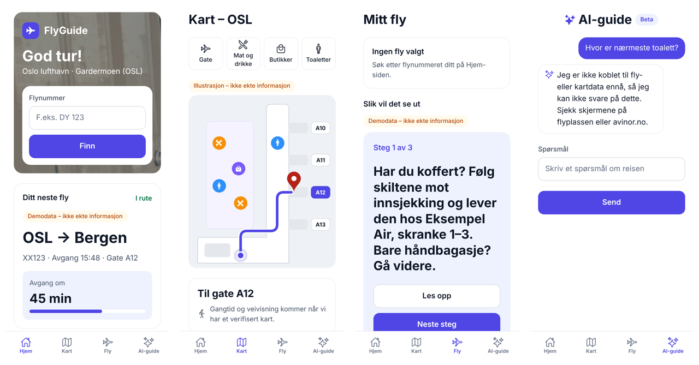

# FlyGuide ✈️

Finn frem. Reis enklere.

> 🚧 Status: Under utvikling, ikke klar til bruk ennå. Fase 1 av det nye designet er ferdig.

FlyGuide er en mobilapp som gjør det enkelt for eldre å finne frem på Oslo lufthavn Gardermoen.

<p align="center">
  
</p>

<p align="center"><em>Slik ser appen ut nå. Flydata, steder og kartet i videoen er eksempeldata.</em></p>

<p align="center">
  
</p>

---

## Hvorfor lager jeg dette?

Gardermoen er en stor flyplass. Mange synes det er stressende å finne riktig gate, spesielt når tiden er knapp, når gaten plutselig endres, eller når man ikke reiser så ofte.

Informasjonen finnes, men den er spredt: på skjermer i terminalen, på nettsider og på skilt. Jeg vil samle det du trenger på ett sted, i en app som er enkel å bruke for alle, også for de som ikke er vant med teknologi.

Avinor har allerede en god app, men den har mye på én gang. Mange eldre synes det er vanskelig å finne frem i den, og på flyplassen.

Derfor lager jeg en app som gjør én ting: viser deg steg for steg hva du skal gjøre, fra du kommer inn døren til du står ved gaten.

---

## Hva skal appen kunne gjøre?

- Steg for steg: Skriv inn flynummeret, så får du en enkel liste. For eksempel: «1. Har du koffert? Følg skiltene mot innsjekking og lever den hos Norwegian, skranke 1–3. Bare håndbagasje? Gå videre. 2. Gå gjennom sikkerhetskontrollen. 3. Gå til gate A15.»
- Stor tekst og få knapper: Én ting på skjermen om gangen.
- Lese opp: Appen kan lese stegene høyt.
- Gi beskjed om endringer: Du får et tydelig varsel hvis gaten eller tiden endres.
- Hjelp på flyplassen: Lett å bestille assistanse og finne toalett eller sitteplass.
- Familie kan følge med: Barn eller barnebarn kan se hvor langt du har kommet.

---

## Mobil først, nett som lettversjon

Inne i terminalen går du med telefonen i hånda, så mobilappen er hovedproduktet. Det er bare der du får varsler i lomma, veivisning mens du går og etter hvert kamera-piler.

I tillegg kommer en enkel nettversjon for det du gjør før du er på flyplassen:

- Sjekke flyet og gaten fra PC-en hjemme.
- Se terminalkartet uten å laste ned noe, for eksempel via en lenke eller QR-kode.
- La familie eller venner følge flyet ditt.

Nettversjonen bruker samme kode som appen, så den koster lite ekstra å lage. Varsler og veivisning finnes bare i mobilappen.

---

## Hva er viktig for meg?

- Ærlig informasjon: Appen skal aldri gjette. Flyinformasjonen kommer fra Avinor, som driver flyplassen. Når noe mangler, sier appen det rett ut.
- Enkel å bruke: Rent og oversiktlig design, store knapper og lett lesbar tekst.
- For alle: Appen skal fungere godt for eldre, for de som reiser for første gang og for de med behov for tilgjengelige ruter.

---

## Hvordan bygges appen?

Appen bygges steg for steg:

1. Grunnmuren: Sette opp prosjektet.
2. Utseendet: Lage skjermene: Hjem, Mitt fly, Kart og Assistent.
3. Flyinformasjon: Hente ekte data fra Avinor.
4. Kart: Lage kart over terminalen.
5. Veivisning: Vise vei til gaten.
6. Assistent og varsler
7. Testing og lansering: Teste og publisere i App Store og Google Play.

Under utviklingen bruker vi eksempeldata, og de er alltid tydelig merket som det.

📄 Den tekniske planen finnes i [docs/PLAN.md](docs/PLAN.md).

---

## For utviklere

Du trenger Node.js 22 eller nyere og pnpm.

```bash
corepack enable        # gir deg riktig pnpm-versjon
pnpm install           # installer alt
```

Kjøre appen:

```bash
pnpm app               # start appen, skann QR-koden med Expo Go på telefonen
pnpm web               # åpne nettversjonen i nettleseren
pnpm api               # start serveren på http://localhost:3000
```

Sjekke at alt fungerer:

```bash
pnpm check             # typesjekk, kodesjekk, formatering og alle tester
pnpm test              # bare testene
pnpm build:web         # bygg nettversjonen
```

Innstillinger for serveren ligger i `apps/api/.env`. Kopier `apps/api/.env.example` for å komme i gang.

Prosjektet er delt i tre:

```
apps/app         Appen (iPhone, Android og nett)
apps/api         Serveren som skal hente flydata fra Avinor
packages/shared  Kode som deles mellom appen og serveren
```

GitHub kjører alle sjekkene automatisk ved hver endring.

Slik jobber vi: hver oppgave får en egen sak (issue) og en egen gren (branch). Endringene sendes inn som små endringsforslag (pull request) på rundt 50–70 linjer kode, med tester. Beskrivelsen av hver endring (commit-melding) skrives på norsk og starter med `ny:`, `fiks:`, `test:`, `dok:` eller `oppsett:`.

---

Laget av Khalid Hashi · MIT-lisens
